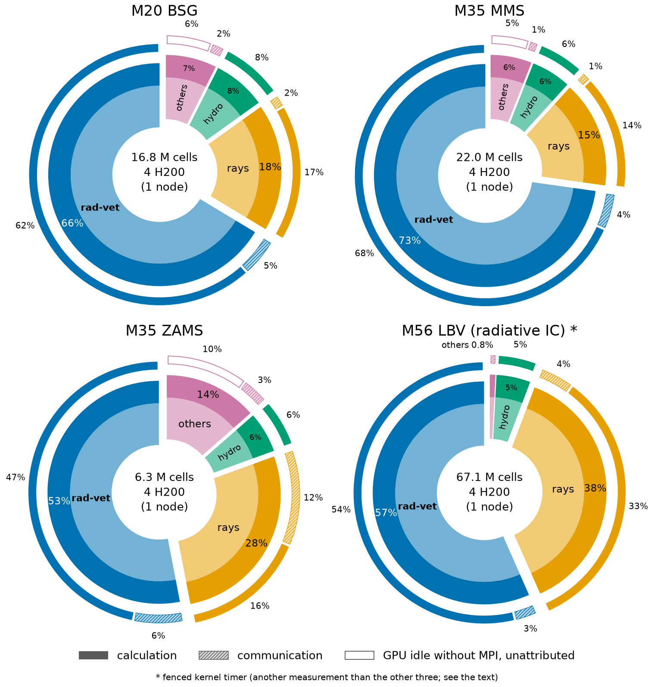

# Performance on 3-D wedges of stars

## **57 days of a blue supergiant in 6.0 hours on one node of 4 H200**

16.8 million cells, 29,657 cycles, 4 MPI ranks on 4 NVIDIA H200 GPUs.

## 1. Wall times of the star runs, one node of 4 H200

| star | mass and type | resolution | model time | **wall time** | status | seconds per cycle, early / late |
|---|---|---|---|---|---|---|
| M20 BSG | 20 Msun blue supergiant | 256 x 256 x 256 (16.8 M cells) | 57.0 d | **6.03 h** | complete | 0.761 / 0.743 |
| M35 MMS | 35 Msun, middle of the main sequence | 336 x 256 x 256 (22.0 M cells) | 10 d | **19.89 h** | complete | 0.660 / 0.962 |
| M35 ZAMS | 35 Msun, zero-age main sequence (ZAMS) | 384 x 128 x 128 (6.3 M cells) | 10 d | **20.08 h** | complete | 0.289 / 0.296 |
| M56 LBV (radiative IC) | 56 Msun, luminous blue variable (T9L6.2) | 512 x 256 x 512 (67.1 M cells) | 31.04 d | **21.99 h** | complete | 2.53 / 3.09 |
| M56 LBV | as M56 LBV (radiative IC), mixing-length start | 512 x 256 x 512 (67.1 M cells) | 31.04 d | **23.64 h** | complete | 2.38 / 3.20 |

- One node, so the node-hours equal the hours. The wall time is the time of the job steps,
  with the start-up and the final restart dump; the pause between two segments of a run (24 to
  30 s) is not counted.
- Early / late: the mean of the first / last 1000 cycles (M20 BSG: cycles 50-1050 and
  28650-29650; a run of two segments: the first of the first, the last of the last segment).
- The runs used development builds made before the release; M35 MMS, M35 ZAMS and M56 LBV (radiative IC) changed
  the build once, at a restart. The cost profiles of section 3 used the release.

## 2. Speed-up over Athena++ on CPUs

| star | mass and type | model time | Athena++ on CPUs | reference of the Athena++ run | AthenaK-VET, one node of 4 H200 | **speed-up in wall time** | **speed-up in node-hours** |
|---|---|---|---|---|---|---|---|
| M20 BSG | 20 Msun blue supergiant | 57.0 d | 3 weeks (504 h) on 20 CPU nodes = 10,080 node-h | [Ma, Bildsten and Jiang (2026)](https://arxiv.org/abs/2609.28656); cost: estimate | 6.03 h = 6.03 node-h | **84 x faster** | **1,670 x faster** |
| M35 MMS | 35 Msun, middle of the main sequence | 10 d | 960 h on 75 CPU nodes = 72,000 node-h | [Schultz, Bildsten and Jiang (2022)](https://arxiv.org/abs/2110.13944), model T35L5.2 | 19.89 h = 19.89 node-h | **48 x faster** | **3,620 x faster** |
| M35 ZAMS | 35 Msun, zero-age main sequence (ZAMS) | 10 d | 960 h on 75 CPU nodes = 72,000 node-h | [Schultz, Bildsten and Jiang (2022)](https://arxiv.org/abs/2110.13944), model T42L5.0 | 20.08 h = 20.08 node-h | **48 x faster** | **3,590 x faster** |
| M56 LBV (radiative IC) | 56 Msun, luminous blue variable (T9L6.2) | 31 d (745 h) | 60 million CPU hours on Mira for three stars; an equal third = 20 million CPU hours = 1.25 million node-h (16 cores per node) | [Jiang et al. (2018)](https://arxiv.org/abs/1809.10187), model T9L6.2 | 21.99 h = 21.99 node-h | not stated | **about 56,800 x faster** |

Sources of the Athena++ numbers:

- M20 BSG: "3 weeks on 20 CPU nodes" is an estimate, not stated in the paper; a week
  is taken as 7 days. The paper (Ma, Bildsten and Jiang 2026, arXiv 2609.28656) gives 10,485,760
  cells, 120 angles and 57.4 d of model time, and no cost. Our run has 16.8 M cells and 57.0 d.
- M35 MMS, M35 ZAMS: Schultz, Bildsten and Jiang (2022, arXiv 2110.13944) state that 3000 Skylake
  cores took 4 days for 1 day of model time, for these simulations, not separated by star. We take
  40 cores per node (75 nodes): the Skylake nodes of NASA's Electra have two 20-core Xeon Gold 6148.
  The papers name NASA NAS and "Skylake cores" but not the machine; the same group used Electra's
  Skylake nodes for other star runs ([NASA at SC23 showcase](https://www.nas.nasa.gov/SC23/research/project45.html)), so this is an inference.
  10 d of model time is then 40 days = 960 h.
- M56 LBV (radiative IC): Jiang et al. (2018) state 60 million CPU hours on Mira (INCITE award at Argonne), besides NASA and NERSC
  resources, for their three simulations (T9L6.2, T19L6.4, T19L6) together. We assume an equal third, 20 million
  CPU hours, for T9L6.2 and leave out the NASA and NERSC share; Mira nodes have 16 cores. Their T9L6.2 run reaches
  about 745 h (Fig. 4), like our 31 d. The wall time is not stated. Our run took 21.99 h for 31.04 d. M56 LBV: no published cost found.

This is not like for like:

- The hardware is of different generations, and one GPU node is counted as one CPU node.
- The algorithms differ: the radiation is solved here by an implicit two-moment solver with a
  ray-traced closure, there by evolving the angles. The time steps, the angles, the tolerances and
  the cell numbers differ too.
- The deep sideways motion of M35 MMS is unexplained.

## 3. Where the time goes

*Share of the wall time per cycle of four star runs on one node of 4 H200, by module: hydro (hydro,
gravity, EOS, history), rays (ray sweep, ring, closure from the rays), rad-vet (the implicit
radiation and gas-radiation solve with its halo exchange) and others. Outer arcs: calculation (solid),
communication (hatched), GPU idle without MPI and unattributed (white). Vector form:
[cost_pie.svg](performance/cost_pie.svg).*

Most of a cycle is the implicit radiation solve (53-73 %), then the rays (15-38 %); the
hydrodynamics is 5-8 %. Communication is all the GPU time of packing, copying, unpacking and
waiting kernels, the GPU-to-GPU copies, and the time the GPU is idle while the CPU is in an MPI
call: 7-8 % in M20 BSG, M35 MMS and M56 LBV (radiative IC), 21.5 % in M35 ZAMS, whose ray exchange sends 3.4 GB per cycle and GPU
(M20 BSG: 0.4 GB). The time waiting for a slower rank counts as communication. The rays are traced again in
every cycle, so there is no cheaper cycle without them. The numbers are the mean of the 4 ranks over 24 cycles (M35 ZAMS: 12, M56 LBV (radiative IC): 25), late in the runs
(M20 BSG at 56.0 d, M35 MMS and M35 ZAMS at 9.0 d, M56 LBV (radiative IC) at 24.0 d), without output.

| module | part | M20 BSG | M35 MMS | M35 ZAMS | M56 LBV (radiative IC) * |
|---|---|---|---|---|---|
| **hydro** | total | 50.3 (7.7 %) | 51.2 (5.8 %) | 17.2 (5.9 %) | 131.1 (4.9 %) |
| | calculation | 50.1 (7.7 %) | 51.0 (5.7 %) | 17.1 (5.9 %) | 130.8 (4.9 %) |
| | communication | 0.2 (0.0 %) | 0.2 (0.0 %) | 0.1 (0.0 %) | 0.4 (0.0 %) |
| **rays** | total | 120.7 (18.5 %) | 138.1 (15.5 %) | 80.2 (27.5 %) | 999.8 (37.6 %) |
| | calculation | 110.5 (16.9 %) | 127.2 (14.3 %) | 45.4 (15.6 %) | 887.6 (33.4 %) |
| | communication | 10.2 (1.6 %) | 10.8 (1.2 %) | 34.8 (11.9 %) | 112.3 (4.2 %) |
| **rad-vet** | total | 432.8 (66.4 %) | 648.4 (72.8 %) | 154.6 (53.0 %) | 1504.2 (56.6 %) |
| | calculation | 402.0 (61.6 %) | 608.5 (68.3 %) | 136.6 (46.9 %) | 1430.6 (53.8 %) |
| | communication | 30.8 (4.7 %) | 39.9 (4.5 %) | 18.0 (6.2 %) | 73.6 (2.8 %) |
| **others** | total | 48.3 (7.4 %) | 53.3 (6.0 %) | 39.4 (13.5 %) | 21.9 (0.8 %) |
| | communication | 10.9 (1.7 %) | 10.4 (1.2 %) | 9.7 (3.3 %) | 21.9 (0.8 %) |
| | unattributed | 4.7 (0.7 %) | 5.8 (0.7 %) | 3.1 (1.1 %) | not measured |
| | GPU idle | 32.7 (5.0 %) | 37.1 (4.2 %) | 26.6 (9.1 %) | not measured |
| **all modules** | communication | 52.1 (8.0 %) | 61.3 (6.9 %) | 62.6 (21.5 %) | 208.2 (7.8 %) |
| sum | ms per cycle | 652.1 | 890.9 | 291.4 | 2657.1 |
| same run without a profiler | ms per cycle | 633.7 | 864.4 | 279.8 | 2558.6 |

Milliseconds per cycle, with the percentage of the sum in brackets. Data:
[cost_modules.csv](performance/cost_modules.csv), made by
[cost_modules.py](performance/cost_modules.py) from the profiler tables; figure:
[cost_pie.py](performance/cost_pie.py). Section 1 and 2: [wall_times.csv](performance/wall_times.csv),
[speedup.csv](performance/speedup.csv).

**\* M56 LBV (radiative IC) is another measurement.** The profiler did not finish on it, so its kernel times come from
a timer that waits for the GPU after every kernel. This makes short kernels longer, hides overlap, and cannot see
GPU idle time. The MPI time is the host time of a run without the waits. Their sum, 2657 ms, is 3.9 % more
than the 2559 ms of the same run without a timer, and the shares are of 2657 ms. Start-up and output
kernels are left out, and with them a generic 4-D array copy (92 ms per cycle if it were all in the cycles; in
the other stars such copies are about 1 ms, so it is taken as start-up).

How the parts were assigned (M20 BSG, M35 MMS, M35 ZAMS: the NVIDIA profiler, release build):

- GPU kernels + GPU copies outside kernels + GPU idle = wall of the window. The sum closes to 0.1 ms,
  but by construction: the copies are the wall minus kernels minus idle. A check of it: the copied
  bytes per cycle (2.81 GB in M20 BSG) agree with the bytes given to MPI (2.84 GB). The profiled cycles
  are 3-4 % longer than those without a profiler.
- Communication kernels: halo pack, copy, unpack and the ghost cells at the walls inside the solve
  (rad-vet); pack, unpack, list and signal-wait kernels of the ray exchange (rays); the exchange of
  hydro and radiation boundary cells and of the seam fluxes (others); the flag exchange of the
  first-order flux correction (hydro).
- Some kernels share one name in the profiler table (the halo kernels, the hydro fluxes, the dot
  products of the solver). They are split by their full names on rank 0; what could not be named
  (0.2-0.5 %) is "unattributed", as are generic array copies and fills (0.2 %) and copies that are not between
  GPUs (below 0.4 %).
- Copies between GPUs are divided among the modules by the bytes sent at each MPI call site, and the
  GPU idle time during MPI (M20 BSG 3.0 %, M35 MMS 2.7 %, M35 ZAMS 8.3 %) by the host time in MPI at each call site
  (from a separate run). A call site is known by the last kernel launched before it. These two
  divisions are estimates, and the second includes the first cycle, which makes "others" larger.
- The rest of the GPU idle time (launching, synchronisation, small copies) cannot be given to a
  module and is in "others".
