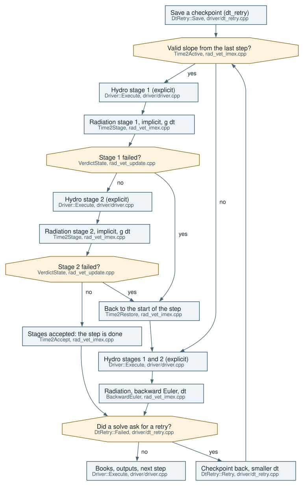

# The VET radiation scheme: method and properties

This page describes the default grey radiation scheme for implicit transport (keys:
[Keys](KEYS.md)). It stays at the level of the method and its properties. The tests named below
are those of the test suite (see [Tests](../../tests/vet_clean/README.md) for the decks and the
exact criteria).

## 1. The method in brief

One time step: the hydrodynamics is explicit, the radiation and its exchange with the gas are implicit in two
stages. A step whose stage fails is done again with one implicit solve, and a step that still fails is taken
again at a smaller size.

The radiation solve, the closure and the files are drawn on [WORKFLOW.md](WORKFLOW.md) (code layout).

### Features

- **Second order in time and space.** Measured orders of the finest pair: 1.8 in time, 1.9-2.3
  for cells and time step refined together, and 2 also where the gas-radiation exchange is stiff
  (tests `order_time`, `order_space`, `order_stiff`; section 2, Properties;
  worked examples in [Notebooks](../../tests/vet_clean/notebooks/README.md)). The implicit discrete-ordinates
  radiation of Athena++ (Jiang 2021) is, as that paper states, first order in time.
  What the order means: the error falls as a power of the cell size. With second order, 10 times
  finer cells make the error 100 times smaller; with first order only 10 times smaller. Put the
  other way: to make the error 10 times smaller, a second-order method needs cells about 3 times
  finer, a first-order one 10 times finer. In 3-D the cost grows as the fourth power of the
  resolution (three directions, and a time step that shrinks with the cell), so that is about 100
  times the cost against 10,000 times. The same holds for the time step: a code whose radiation is
  first order in time (backward Euler) needs much smaller steps for the same accuracy, or accepts a
  larger error at the same cost.
- **Many angles.** The Eddington tensor comes from rays along a fixed set of directions, 126 in
  the star templates (Gauss-Legendre 7 x 18). Crossing beams pass through each other, and a clump
  leaves a sharp shadow (0.6 % of the radiation left in its umbra); an M1 closure merges the
  beams and fills the shadow (tests `idort_beams`, `shadow`).
- **Speed.** 57 d of a blue supergiant (16.8 million cells) in 6.0 h on one node of 4 H200;
  48-84 times faster in wall time than the Athena++ CPU runs of the same three stars, which
  differ in hardware, angles and cells ([performance page](PERFORMANCE.md)). A step normally
  costs one ray sweep; the implicit solve takes 53-73 % of a cycle, the rays 15-38 %. Maps and
  movies of the runs: the Gallery page of the documentation site.
- **Iterations per step.** A step has two implicit stages. In the four star runs a stage takes
  2.2-4.1 Newton passes on average (mostly 2 to 5), each one linear solve of 5.5-7.4 BiCGStab
  iterations on average, so 15-24 iterations per stage, plus one ray sweep per step. No step had
  to be retried or redone (0 of 380,141 steps; from the solver's per-stage log lines).
- **Conservation and positivity.** Gas + radiation energy and mass are conserved to round-off,
  $L_z$ exactly on the cubed sphere; linear momentum is not conserved in general. Second order
  with local first-order fallbacks where positivity needs them, all counted (Positivity, below;
  section 2, Properties).

**Equations.** Two-moment grey radiation transport for the radiation energy
density $E$ and flux $\mathbf F$, in the mixed frame: lab-frame moments with
comoving-frame opacities, keeping the $O(v/c)$ terms and the $O(\beta^2)$ terms that are
leading order in dynamic diffusion (Krumholz et al. 2007; the β terms follow Ma et al. 2025,
eqs. 56-57):

$$
\partial_t E + \nabla\!\cdot\mathbf F = -c\,G^0,\qquad
\partial_t \mathbf F + c^2\,\nabla\!\cdot(\mathsf D\,E) = -c^2\,\mathbf G ,
$$

where $G^0$ and $\mathbf G$ are the energy and momentum exchange with the gas
(absorption, emission, scattering). The gas receives exactly the opposite:
$\partial_t(\rho e_{\rm tot}) \mathrel{+}= c\,G^0$, $\partial_t(\rho\mathbf v) \mathrel{+}= \mathbf G$.
The gas EOS is gas-only (any AthenaK EOS, including tabulated ones); radiation pressure acts on
the gas only through $\mathbf G$. The scheme requires the full speed of light, $\hat c = c$.

**Closure: variable Eddington tensor from rays.** $\mathsf D = \mathsf K/J$ comes from a
formal solution of the grey transfer equation $\hat n\cdot\nabla I = \chi(S - I)$ along a
fixed set of global directions (the `vet_gd` rays: a Gauss-Legendre product set,
level-symmetric, geodesic or HEALPix set). The sweep is a short-characteristics sweep over
the whole mesh, shell by shell on spherical-polar and cubed-sphere meshes (Cartesian meshes
use a Cartesian short-characteristics sweep, optionally with the same sets). The source
function is the state's own ($\epsilon\,aT^4 + (1-\epsilon)E$, or an absorption/scattering
split), so the closure does not depend on $\Delta t$. Besides $\mathsf D$, the rays give the
half-range fluxes (outgoing and incoming parts of the flux) and the rays' own flux through
each face, which the face fluxes use in optically thin regions. Normally a step costs one ray
sweep: the second stage uses an extrapolation of the closure in time.

**Where the rays start.** The rays are not swept through the whole star. On 3-D
spherical-polar and cubed-sphere meshes with one MeshBlock along the radius (the star runs),
the sweep starts at a shell chosen automatically, the ray cut: in each column, the lowest cell
that is thinner than one optical depth or where the source function changes by 1 % or more per
optical depth, then 10 optical depths deeper; the deepest cut of all columns is used. The cut
moves down at once and up only after 10 ray builds, and restart files keep it. Below the cut
the closure is the diffusion limit of each cell's own $E$ and $\mathbf F$ (the intensity
$J + 3\,\hat n\cdot\mathbf H$ in every direction), whose error there is at most of the order of the
square of that 1 %. Outward rays start at the bottom of the swept shells with the diffusion
intensity $S + \mu\,(-dS/d\tau)$; inward rays start at the top with no incoming radiation (or
a bath or a mirror where the boundary asks for one). On a periodic wedge, a ray that leaves
through one side comes back through the other side in the matching direction of the set.
Each build sweeps every direction once: inward rays top-down, then outward rays bottom-up,
one shell at a time. Cartesian meshes sweep all cells, layer by layer. The settings are on
[Keys](KEYS.md).

**Scattering without a scattering iteration.** Electron scattering enters twice. In the moment
equations it is part of the total extinction in the flux equation and, in the energy equation,
of the O(v/c) work of the radiation force on the gas (with the flux-mean opacity) and the
$O(\beta^2)$ terms; it exchanges no heat (grey, coherent and isotropic in the comoving frame). All
of this is linear in $E$ and $\mathbf F$ and solved implicitly with the rest, so the moments carry
the scattering exactly. In the rays' source function the scattering part needs the mean intensity $J$
(`vet_scatter`, `vet_scatter_form`; absorption and scattering split as in Ma et al. 2026). $J$ is not iterated from the rays (a lambda iteration, which converges
very slowly where scattering dominates): it is taken from the moment solution, $J = E$ at the end
of the stage (`vet_scatter_j = relaxed`). The rays then give only the shape of the field, $\mathsf
D = \mathsf K/J$, which depends weakly on $S$; the moment system does the work of the iteration,
as in a variable-Eddington-tensor or synthetic-acceleration method. The steady start
repeats rays and moments to convergence; in a run the closure is updated
once per step.

**Rotating rays.** A fixed set of directions leaves ray effects: light from a hot spot or a
compact source travels only along the directions of the set, and the closure carries that
pattern. On the cubed sphere the set is rotated every `vet_gd_rotate_dt` of physical time
(`auto` = 20 times the first time step), and the closure is an exponential moving average over
the rotated sets (`vet_rotate_avg_ema`, 128), so the pattern averages out instead of being frozen
into the solution. With `vet_rotate_avg_ema_wb = true` a static envelope keeps its closure and its
equilibrium across a turn (section 2, well balance). Spherical-polar wedges use a fixed set
(`vet_gd_rotate_dt = 0`, the default there); the RSG and HG runs rotate.

**Staggered layout.** $E$ lives at cell centres; the radiation flux lives on the cell faces,
one normal component per face. The face flux of a stage is a blend of

- a compact diffusion / wave flux, $-(c/\chi_f)\,\partial_n(\mathsf D E)$ in the optically
  thick limit and the staggered wave operator in the thin limit (no added dissipation needed);
- a kinetic (upwind discrete-ordinates) flux from the rays' half ranges, which takes over where
  the field is anisotropic;
- the advective flux $\mathbf a E$ of radiation carried by the gas, and lagged terms (the
  off-diagonal stress and a consistency correction towards the rays' own thin-limit flux).

**Time integration.** The scheme is second-order accurate in time. The hydrodynamics is
AthenaK's explicit two-stage integrator (`rk2`); the radiation and the gas-radiation exchange
are implicit, with a two-stage implicit Runge-Kutta method (`time2_tableau = sdirk2`). The two
parts are coupled so that the whole step stays second order, also where the gas-radiation
exchange is stiff.

**Implicit stage solve.** In each stage the face momentum equation is eliminated face by face,
which leaves a scalar system for $E$. It is solved by Newton passes: each pass is a
right-preconditioned BiCGStab with a line-relaxation multigrid preconditioner, followed by an
exact per-cell root for the gas temperature (any EOS; in the stage-2 solves
the secant chord replaces the tangent only where it is better by more than a derived round-off
bound, 16 eps of the terms of $e(T) - e(T_p)$), then a line solve that recovers the face
fluxes. Convergence is measured in each cell's own energy budget of the stage, with the
tolerance tied to the step's time-error estimate.

**Positivity.** No linear scheme above first order keeps a solution positive for every step
(Godunov 1959). The scheme is therefore second order where nothing is near zero and falls back
to a first-order positive form only locally, where it is needed; every such event is counted
(the end-of-run `vet-positivity` line, the FOFC and backward-Euler counts). From first to last:

- hydrodynamics: first-order flux correction (`hydro/fofc`, `fofc_retest`;
  `hydro/hydro_fofc.cpp`): a trial update flags every cell where a floor or the velocity
  ceiling would act, and the faces of that cell take the first-order LLF flux.
  `dfloor_flux_limit` scales back the outflow of a nearly empty cell so that its density
  stays above the floor;
- radiation energy $E$: the implicit operator is an M-matrix for any step (donor-cell and
  smallest-donor parts), and Zalesak limiters on the explicit stage increment and on the
  written-back fluxes keep $E$ above `e_floor`;
- time: a failed implicit stage is redone with backward Euler (first order, L-stable), and a
  step that still fails is taken again with a smaller dt (`time/dt_retry`);
- last: floors, which take their energy from the cell's gas or radiation (`implicit_pos_floor`,
  the gas positivity rule, `hydro/floor_pay = rad_column`) and are counted.

In the four finished star runs no stage fell back and no step was redone or retried; the only
backward-Euler step of each run was the first step of its fresh start. Every suite deck runs
with no floor raise, no energy created and no solver warning (except `floor_pay`, which raises
the gas temperature on purpose and pays it from the radiation).

**Well-balanced formulation.** For a hydrostatic envelope in radiative equilibrium, the
problem generator supplies the reference radiative acceleration of the initial state; the
well-balanced hydro already holds it, and the radiation hands the gas only the residual
force. The face flux equations are written as deviations from the rays' own steady state,
and a steady start relaxes the initial radiation to the scheme's own
discrete steady solution in the given gas.

## 2. Properties

Each property is stated as it holds with the production keys of the templates, with the
reason it holds, where it stops holding, and the test in `tests/vet_clean` that checks it.
"Exact" means to round-off.

| property | status |
|---|---|
| energy (gas + radiation) | exact; floors are paid from the radiation |
| mass | exact |
| angular momentum L_z | cubed sphere: exact (no ledger); spherical polar: exact except where the face-flux cone cut acts (booked in a ledger), exact there too with `clean_stag_fcone_lz` + `clean_lz_spin` |
| linear momentum | not conserved in general: the cone cut, the well-balancing residual and the floor velocity rules change it (not booked); gravity is a source; not a discrete invariant on spherical-polar / cubed-sphere meshes |
| positivity | density by construction; E by the implicit operator and Zalesak limiters, with counted backstops; gas internal energy not by construction (the step is redone, or the radiation pays) |
| well-balance | equilibrium envelopes stay at rest to below 1e-8 of the sound speed |
| order | successive orders of the finest pair: 1.8 (time ladder of deck D), 1.9-2.3 (grid + time ladder of a linear wave); 2 also where the gas-radiation exchange is stiff (`order_stiff`) |
| radiation-acoustic waves | phase speed and damping right in every trapping regime |
| diffusion limit | the right diffusion coefficient at any cell optical depth (asymptotic preserving) |
| moving media | radiation advected with the gas; comoving diffusion Galilean invariant |
| restart, dt retry | bitwise |
| reproducibility | bitwise across rank counts; across tile layouts with the conditions below |
| CPU / GPU | agreement to round-off, not bitwise |
| no silent fallbacks | every change of method prints or stops the run |
| phi mirror symmetry | exact on wedges of whole azimuthal periods; on narrow wedges with `vet_gd_wall_sym` |
| meshes | Cartesian, spherical polar, cubed sphere; one implementation |

### Energy (gas + radiation): exact

$E$ is updated in flux form with one energy flux per face, shared by the two cells. The gas
takes exactly the energy the radiation gives up in each cell, including the kinetic energy of
the radiation force, and any later correction to $E$ is moved to the gas with the opposite
sign. The positivity limiters scale a face's flux on both sides at once. The density,
pressure and radiation floors take the energy they need from the radiation of the same cell
or its radial column (`<hydro>/floor_pay = rad_column`, `implicit_pos_floor`).
With `floor_pay_skip = true` (production) the energy changed by the density floor and the
velocity ceiling is paid as well. The initial conversion's floors are paid before the t = 0 output.
With `<hydro>/floor_from_ekin` (general EOS) a fast cell pays its floor deficit from its own
r / theta kinetic energy instead (E kept, $L_z$ kept: the phi momentum is never scaled).
Energy is created only when a column holds too little radiation to pay; each such event
prints a `CLEAN WARNING`.

Test: `conservation_sp`, `conservation_cs` (closed rotating shells, dE/E <= 1e-13; measured
about 1e-15), `thermal_eq`, and `floor_pay` (general EOS with a temperature floor that acts in
most cells every cycle, paid from the radiation: dE/E <= 1e-13 from t = 0; and with
`floor_from_ekin` and a velocity ceiling below the shell's speeds: dE, dM, dLz <= 1e-13).

### Mass: exact

The radiation solve never changes the density, so mass conservation is that of the hydro,
which is in flux form.
With `<hydro>/dfloor_flux_limit` the outflow of a nearly empty cell is scaled back so that its
density cannot fall below the floor, and both neighbours see the same scaled flux; the density
floor of the primitive-variable recovery stays as a backstop (counted in the event log). The
held gas then also moves only as fast as its scaled flux: the cell's momentum, except its L_z
part, is scaled by the same factor at fixed total energy (the kinetic energy becomes heat).
Without this, gravity and pressure would keep accelerating gas whose work (carried by the mass
flux under `etotgrav`) never arrives, until its kinetic energy exceeds its energy. The removed
x1 momentum and the heat are printed at the end of the run. The
open stellar boundaries remove mass by design, and the history records it.

Test: `conservation_sp`, `conservation_cs` (dM/M <= 1e-13).

### Angular momentum $L_z$: exact on the cubed sphere; on spherical polar exact except where the cone cut acts

On a spherical-polar mesh the azimuthal radiation stress is written in torque form, so it
cancels between neighbouring cells; `clean_stag_fwb_ring = 1`
removes the net torque of the
well-balancing residual on each azimuthal ring. On the cubed sphere the panel faces are not
azimuthal faces: each cell's gas takes its absorption torque, and the part that cannot cancel
locally is collected each solve and given back to the gas as a uniform rigid spin. This
conserves $L_z$ exactly but not locally.

Whatever $L_z$ the radiation step still changes goes into a ledger, stored in the restart
file. The history column `Lz_tot` is gas + radiation + ledger. Because the ledger books
exactly what the step changes, `Lz_tot` is constant by construction; the scheme's $L_z$
error is the growth of the ledger, i.e. the drift of gas + radiation alone (`dLz_gr` in the
test output).

- Spherical polar, production keys: the face-flux realisability cut (`clean_stag_fcone`)
  removes momentum the gas does not take, and its $L_z$ goes into the ledger. On the test shell
  this happens on the first cycles of a fresh start and amounts to about 6e-7 of the gas
  $L_z$; the ledger is constant afterwards.
  With `clean_stag_fcone_lz` and `clean_lz_spin` (test `conservation_lz`) the gas takes the
  cut's $L_z$, which is then exact without a ledger (1e-15); not the production setting.
- Cubed sphere: the ledger stays at round-off (1e-17), so gas + radiation $L_z$ is conserved
  without one. Here the radiation's $L_z$ is that of the face momenta; the larger `dLz_gr`
  the test prints (6e-5) uses the cell-centred flux vector and is a diagnostic mismatch, not
  the scheme's $L_z$.
- Not recorded in the ledger: the momentum the floor-gas cap (`floorcap`), the density floor
  with `dfloor_keep_velocity` and the velocity ceiling remove (the ceiling keeps $L_z$ with
  `floor_from_ekin`; what it takes without it is in the `CLEAN FLOORMOM` phi component).

Test: `conservation_sp`, `conservation_cs` (drift of `Lz_tot` <= 1e-13, with `dLz_gr`
printed).

### Linear momentum: not conserved in general

The radiation momentum lives on the cell faces. The gas receives, face by face, minus the
change of the radiation momentum of that face, shared between the two cells, and the
radiation stress is in flux form. Gravity and the open boundaries change the momentum as
physical sources. Three things change gas + radiation momentum without being given to the gas:

- the realisability cut of the face flux (`clean_stag_fcone`);
- the residual of the well-balanced face rows;
- the floor-gas momentum removal (`floorcap`, `dfloor_keep_velocity`, the velocity ceiling).

Their sizes are printed (`CLEAN FCONE`, `CLEAN FWB`, the `floorcap` line; what the primitive
recovery takes per step, signed, by cause: `CLEAN FLOORMOM`, test `floor_momentum`), but there
is no ledger of the total. In a periodic Cartesian box at small amplitude, where none of
them acts, momentum is conserved to round-off (1e-16); in a violent stress test the well-balancing
residual changes it by about 6e-7 and the production cut by up to a few 1e-3 per cycle. On
spherical-polar and cubed-sphere meshes Cartesian momentum is not a discrete invariant (the
momenta live in local bases), so only $L_z$ and the radial budget are meaningful there.

Test: `momentum_box` (a periodic Cartesian box) reports the drift; it is a report, not a
conservation claim (the shell decks have closed walls that exert forces).

### Positivity

How second order and positivity go together (local first-order fallbacks, all counted) is
described in section 1, the method in brief, under **Positivity**.

- **Density** stays above its floor by construction
  (`dfloor_flux_limit`, above).
- **Radiation energy $E$** is non-negative by construction of the implicit operator: it is an
  M-matrix for any Eddington tensor and step (the kinetic share has $h^+\ge0\ge h^-$, the
  advective flux takes the smallest donor share that keeps the M-matrix, the off-diagonal
  stress enters in donor-cell form). Zalesak limiters on the explicit stage increment and on
  the written-back fluxes keep $E$ above `e_floor`; they scale only the energy flux, so
  momentum is untouched. A floor remains behind them; it takes its energy from the cell's gas
  or its column and is counted. The cone limit keeps $|\mathbf F|\le cE$.
- **Gas internal energy** is not positive by construction. A step that would make it
  negative is rejected and repeated (backward Euler, then a smaller dt), or the missing energy
  is taken from the radiation of the same cell or its radial column (energy-conserving).

All such events are counted in the end-of-run `vet-positivity` line. Test: every suite deck
runs with no floor raise, no energy created and no `CLEAN WARNING` (`floor_pay` raises the gas
temperature on purpose, and pays it from the radiation); `diffusion` (a top-hat in E at
tau_cell = 1e4 stays within [background, background + amplitude] to round-off) and `marshak`
(a Marshak wave into a cold slab: E and T_gas positive and below the bath values).

### Well-balance: equilibrium envelopes stay at rest

A star in hydrostatic and radiative equilibrium is designed as a steady state of the discrete
equations. The gas sees only the deviation of the radiative force from a reference force that
balances gravity (`force_reference = wb_arad`, held by the well-balanced hydro), and the face
flux rows are written about the rays' own steady state (`clean_stag_fwb`). The steady start
(`clean_init = steady`) begins from the scheme's own discrete equilibrium. The remaining
motion is at the solver-tolerance level, not round-off.

A rotating ray set is a new angular discretisation at every turn, so its closure of the same
static state differs by the set's pattern error (~1e-4 in F) and a static envelope has no
discrete equilibrium to keep (v/c_s ~1e-4 - 1e-3). With `vet_rotate_avg_ema_wb = true` the
EMA ring takes up the pattern change of a turn in its offsets (the boundary's same-state
Delta, weight a = a_ch alone, a_ch the change test of one set at two times): a set change
then moves the closure only where the state moved, so a static state keeps its closure, its
force and its equilibrium for any turn and cross-fade weight. On the cubed sphere the ring
also carries the cells' face half ranges. The K-set
window (`vet_rotate_avg` without the EMA) has no such form: its window changes the closure of
a static state at every turn.

Test: `wb_sp`, `wb_cs` (max |v|/c_s <= 1e-8 over the run; measured 6e-9 and 5e-10; with
the rotating sets `_rot` 6e-9 and 7e-9).
`wb_cs` withholds the static radiation force and cannot see a spurious one on the cubed
sphere; `shell_force_cs` (`clean_cs_lat_wb`) does.

### Order of accuracy in space and time

The face terms are second order in space by design. What the tests measure:

- Time, deck D (spherical shell, kinematic gas, dt halved from 1/16 to 1/256 on a fixed
  grid): the successive orders are 1.57, 1.61, 1.84 (E), 1.50, 1.52, 1.81 (F_r) and 1.34,
  1.43, 1.83 (T), below 2 on the whole ladder. The finest pair differs by 3.15e-5 (E),
  1.68e-4 (F_r) and 6.9e-6 (T). The loss is attributed to the weight 1/(1 + z), z = c dt/dx,
  of the stage-2 closure line (not measured on this release).
- Grid and time step together, a linear radiation-hydro wave (N = 16 ... 128): the orders are
  2.12, 2.26 (E) and 1.48, 1.95 (v); the finest pair differs by 4.36e-3 (E) and 9.81e-3 (v).

The exchange is not stiff in either deck. Where it is stiff, the production tableau
(`time2_tableau = sdirk2`) is second order with `time2_gtime_slope` (the default on a fresh
run; `order_stiff`, a trapped radiation-acoustic wave) and first order without it: on a
radiation-acoustic wave (64 cells, dt halved) the successive orders of E without it are 1.08,
1.04 at x = 100 and fall 1.51, 1.34, 1.20 at x = 1 and at x = 10 (`time2_tableau = hesdirk2`:
2.0 in all three; from a study on this release, not a suite test).

Test: `order_time` (order of the finest pair >= 1.7), `order_space` (linear
radiation-hydro wave on a Cartesian mesh, finest pair >= 1.7), `order_stiff` (trapped
radiation-acoustic wave, time step halved, finest pair >= 1.7).

### Radiation-acoustic waves in every trapping regime

A small sound wave in gas + radiation is damped by the radiation and, where the radiation is
trapped, travels at the mixture sound speed. The scheme reproduces the analytic root of the
linear gas + moment system (with its own closure and exchange) from the free-streaming
($x = 0.01$) through the intermediate ($x = 0.1$, 1) to the trapped limit ($x = 100$), at
cfl 0.3 and the larger dt that `rad_signal_speed_diff` gives in thin gas (2.7 x at $x = 0.01$).

Test: `radwave` (phase speed within 3e-3, damping within 5e-3 per radian, no growth).

### Closure accuracy: beams, shadows, emitting bodies, non-LTE atmospheres

The Eddington tensor and the thin-limit face fluxes come from the rays, so radiation that is
far from isotropic keeps its direction: crossing beams pass through each other, a beam
behind an opaque cloud leaves a sharp shadow, and the field around an emitting cylinder
follows exact transport (an M1 closure merges crossing beams and fills shadows). Each beam
of the test, 4 cells wide, stays straight at its angle but carries 1.19 x the exact energy
(the cap of the streaming share at its edges), while its energy flux equals the injected flux to 6e-8. Around
the cylinder E and the energy flux Phi are within 1.1 % and 1.2 % of exact transport; the face
momentum F there is about 20 % above it (likely the
harmonic face opacity at the sharp edge; not measured).

Test: `idort_beams` (L1 of E and the beam energy within 5 % of 0.1772 and 1.193), `idort_shadow`, `idort_shadow_gl` (L1
0.014 and 0.013), `idort_cylinder` (E and Phi outside 0.011 and 0.012), `nlte_eps1e-1`, `nlte_eps1e-4` (J
against exact transport, L1 1e-4 and 1.3e-3); `idort_beams_mb` (4 MeshBlocks: identical in
tile mode); `shadow` (a clump lit by an isotropic bath: 0.6 % of the unshadowed radiation is
left in the geometric umbra behind it, bound 2 %; regions whose sight lines miss the clump
unchanged to 2 %).

### Radiation hydrodynamics: radiative shocks and stiff exchange

The coupled scheme holds the Lowrie & Edwards (2008) non-equilibrium radiative shocks at their
semi-analytic profiles, precursor, Zel'dovich spike and relaxation region included, without
a shift of the shock (with `clean_closure = eddington`, as the reference is grey
non-equilibrium diffusion). The gas-radiation exchange is L-stable: at time steps of up to 1e5
relaxation times the gas reaches the exact equilibrium temperature with the total energy
conserved.

Test: `idort_radshock_m2`, `idort_radshock_m5` (L1 of rho, v, T_gas, T_rad 2.1e-4 to 1.7e-3,
each within 5 % of the reference), `idort_thermal_eq2` (error of T within 5 % of 2e-3 after
5 steps, energy drift <= 1e-13), `thermal_eq`; `radshock`, `radshock_m5` (the same shocks
with the production closure: L1 of rho and T_rad about 0.5 % and 1 %, within 5 % of the
reference values; the difference from the Eddington run is the closure in the thin
precursor).

### Diffusion limit: asymptotic preserving

In an optically thick medium the moment equations must reduce to diffusion with
D = c/(3 rho kappa) however thick a single cell is; a scheme without this property is too
diffusive by a factor ~tau_cell. In the thick limit the staggered face flux is the compact
diffusion flux $-(c/\chi_f)\,\partial_n(\mathsf D E)$ with no added dissipation, so the
diffusion coefficient is right at every tau_cell.

Test: `diffusion` (a Gaussian pulse: variance growth within 2e-3 of 2 D t at tau_cell = 10,
1e3, 1e5 and 1e-4 in 2-D; measured 8e-4, 8e-8, 1e-10, 9e-7).

### Moving media

The equations are mixed frame with the $O(v/c)$ and dynamic-diffusion $O(\beta^2)$ terms,
and the face flux includes the advective flux of radiation carried by the gas, so radiation
trapped in a moving gas moves with it and a uniform medium at the coupling's fixed point
stays there.

Test: `advect_pulse` (a diffusing pulse advected at v against the same pulse at rest shifted by
v t: L1 <= 3e-3, measured 8e-4), `advect_uniform` (a uniform medium at 0.01 c: T changes by
<= 1e-5, measured 5e-10).

### Phi mirror symmetry on narrow wedges

The ray set must map onto itself under the phi-wall mirrors of the wedge and, at a theta
seam, under the equatorial mirror. On a phi-periodic spherical-polar wedge the rays' phi-wall
maps are therefore exact only when the wedge width is a whole number of the direction set's
azimuthal periods (Gauss-Legendre
$n_\theta\times n_\phi$: 360 deg$/n_\phi$; LQ10: 90 deg; the default icosahedral set: 180 deg);
any other width stops the run with a FATAL error. A narrow wedge that cannot meet this
(e.g. 0.064 rad) names `vet_gd_wall_sym = true` with `vet_gd_wall_interp = true`: the set is
turned to have a mirror plane on the wedge centre, the two walls' maps are mirror images, and
the seam face is computed in both frames. A mirror-symmetric state then has a wedge-mean
$F_\phi$ of zero to round-off. On a theta-periodic wedge the theta seam face is likewise computed
from both sides, its other side being the exact equatorial mirror of this side
(`vet_gd_theta_seam_sym = true`, required on theta-periodic meshes: FATAL otherwise), which
removes the one-frame seam face's net $F_\theta$ (the 2.5e-2 mirror error of the 20-deg deck).

Test: `wedge_sym` (a spherically symmetric shell on 3.7 and 7.3 deg wedges with the key and a
20 deg wedge without it: $|\sum F_\phi|/\sum|F_r| \le 10^{-8}$, measured 2e-11 to 3e-9; the
narrow wedge without the key stops with the FATAL; the shell made theta-periodic stops with
the FATAL without `vet_gd_theta_seam_sym`; with it the mean $F_\theta$ is <= 1e-8 of
$\sum|F_r|$ after 8 cycles, measured at round-off).

### Restart and dt retry: bitwise

The restart file carries the full scheme state (stage slope, face momenta, closure history,
ray cut, ledger), so N steps straight and N/2 steps, a restart and N/2 more are identical.
A dt retry restores a full cycle checkpoint, so a retry at the same dt repeats the step
exactly. The restart file also records every key, and a restart uses the recorded value
(see the restart rule in [KEYS.md](KEYS.md)).

Test: `restart_sp`, `restart_cs`, `dt_retry` (difference 0).

### Reproducibility

- **Same binary, same layout:** bitwise from run to run.
- **MPI rank count:** bitwise for the state (dumps, restart files, `hydro.hst`). The columns of
  a `user.hst` that a test problem adds from plain sums (gas, radiation and momentum totals)
  differ by the order of the ranks' partial sums (1e-15 of the largest value; larger relative
  values only where a total is near 0); they are written, not read back. With `<mesh>/layout_invariant = true` (default) every global
  or shell sum goes through an exact binned accumulator, so it does not depend on the order
  of its terms. Test: `mpi_ranks` (1 and 2 ranks).
- **MeshBlock layout, tile mode** (`layout_invariant_mode = tile`, `layout_tile = N`): the
  sums and the multigrid act on fixed N x N lateral tiles. Layouts made of whole tiles are
  bitwise identical when there is one MeshBlock along x1 and, if the theta boundaries are ray
  walls (mirror or vacuum), one MeshBlock along x2, as in the production templates. Splitting
  across such walls gives a round-off difference (below 1e-13 of the largest
  value after 8 cycles, CPU).
- **Block mode** (default): the result depends on the MeshBlock size at the solver
  tolerance, because the preconditioner is MeshBlock-local.
- **Floor-held gas** (density or temperature floor with FOFC): with vacuum theta walls the
  trajectory is not reproducible across layouts, since the rays there differ by round-off and
  the floor flag amplifies it (with and without the uniform `fofc_flag_exchange`; a 1e-12
  input perturbation of one block does the same). In the production set-up (tile mode,
  periodic theta) no relative difference above 1e-10 was found in the dumps of 16 cycles
  (compared at that threshold, not byte by byte).

Test: `layout_tile` (1 x 2 MeshBlocks along phi vs one MeshBlock: identical; 2 x 2, which
also splits theta across the ray walls: bounded at 1e-8); on the cubed
sphere `layout_cs` (one MeshBlock per panel vs 2 x 2: identical).

### CPU / GPU consistency: round-off, not bitwise

One Kokkos implementation runs on CPUs and on NVIDIA and AMD GPUs. The sums are
backend-independent (exact accumulators), and `-ffp-contract=off` (with `--fmad=false` for
CUDA device code) removes fused multiply-add differences. The math libraries (exp, pow, the
EOS) differ between backends, so CPU and GPU agree to round-off on smooth problems and far
below the time-step error on stiff ones, but not bit for bit. See [BUILD.md](BUILD.md) for a
toolchain that does not agree.

Test: the suite on a GPU binary (`tests/vet_clean/README.md`, "GPU builds").

### No silent fallbacks

The scheme never changes method silently. Every backward-Euler redo, dt retry, solver switch
or unconverged acceptance prints a `CLEAN` or `DT_RETRY` line, an exhausted retry is FATAL,
and an unsupported combination of keys (mesh refinement, $\hat c<c$, removed keys or values,
missing prerequisites) stops the run with a FATAL error naming the key. Some counted
corrections (paid floor raises, limiter remnants, the automatic backward-Euler back-off of
`time2_auto_be`) are reported only in the end-of-run summary; the floor-gas cap prints every
`floorcap_report` cycles. See [OUTPUTS.md](OUTPUTS.md).

### Cartesian, spherical-polar and cubed-sphere meshes, one implementation

The face and cell kernels are written once in terms of cell volumes, face areas,
centre-to-centre distances and each cell's local orthonormal frame, which each mesh supplies
(the exact AthenaK volumes and areas on curved meshes). Supported: Cartesian 1-D to 3-D,
spherical polar 1-D to 3-D (wedges, axisymmetric, full sphere (not tested, below); radial
stretching allowed) and the cubed sphere. The mesh must not be refined (FATAL). Two
options are geometry-specific by construction: `clean_stag_fwb_ring` (3-D spherical polar with
periodic phi) and the cubed-sphere torque redistribution.

Tests: the `*_sp` and `*_cs` variants above; `order_space` on a Cartesian mesh.

### In the code but not tested

No deck in `tests/vet_clean` or `inputs/stars` and no test of the suite covers the
following. The properties of this section are not verified there.

| feature | state | what is tested instead |
|---|---|---|
| spherical polar with the poles (full sphere, `<mesh>/use_polar_boundary`) under `vet_gd` | accepted, not tested | wedges clear of the poles; the full sphere on the cubed sphere (`*_cs`) |
| stretched theta (`<mesh>/use_grid_stretch_theta`, `theta_plateau`) under `vet_gd` | accepted, not tested | uniform theta; radial stretching in the star decks |
| several MeshBlocks along x1 under `vet_gd` | the sweep has the code, but the start-up check stops with a FATAL error on spherical polar and the cubed sphere (`meshblock/nx1` must equal `mesh/nx1`), so it cannot be reached | one MeshBlock along x1; several on a Cartesian mesh with `closure = vet_sc` (`idort_beams_mb`) |
| radiation with MHD (`<mhd>` in place of `<hydro>`; `RadiationVet::EmagBuild` takes \|B\|^2/2 out of the gas energy) | accepted with `time2_tableau = hesdirk2` (default) or `trbdf2`, tested on small boxes and shells of the three geometries with Ohmic and ambipolar diffusion, ideal and general EOS (`mhd_vet`, `mhd_geneos`, `mhd_equil`), linear waves (`mhd_radwave`) and well-balanced envelopes (`mhd_wb`: a field's own J x B truncation is not withheld), not on a star and not with super-time-stepping; `sdirk2`, the tableau of the star decks, is FATAL with MHD and matter coupling; `<hydro>` and `<mhd>` together are FATAL | hydrodynamics only |

## 3. Code map

[WORKFLOW.md](WORKFLOW.md): flow charts of a step, a stage, the closure and the linear solve, and the list of files.
Start in `src/rad_vet/rad_vet_tasks.cpp`.  Outside `src/rad_vet`: `driver/driver.cpp` (the step), `driver/dt_retry.cpp`
(checkpoint), `utils/imex_sdirk2.hpp` (tableaux), `utils/repro_sum.hpp` (layout-invariant sums),
`bvals/physics/rad_vet_bcs.cpp`.

## 4. How to cite

- AthenaK: J. M. Stone et al. (2024), arXiv:2409.16053.
- This radiation scheme: a method paper is in preparation; until it appears, cite this
  document with the commit hash of the code you ran.
- The VET approach it follows: Jiang, Stone & Davis (2012), ApJS 199, 14 (Godunov radiation
  MHD with a variable Eddington tensor in the mixed frame); Menon et al. (2022), MNRAS 512,
  401 (VETTAM: VET from ray tracing, coupled implicitly to hydrodynamics).
- Methods it builds on: Ma, Pakmor, Justham & de Mink (2025), arXiv:2503.16627 (mixed-frame
  β terms); Jiang (2021), ApJS 253, 49 (implicit discrete-ordinates radiation, level-symmetric
  sets, scattering split); Davis, Stone & Jiang (2012), ApJS 199, 9 (VET from short
  characteristics); Krumholz et al. (2007), ApJ 667, 626 (mixed-frame sources); Alexander
  (1977), SIAM J. Numer. Anal. 14, 1006 (SDIRK2); Zalesak (1979), J. Comput. Phys. 31, 335
  (flux-corrected transport).
