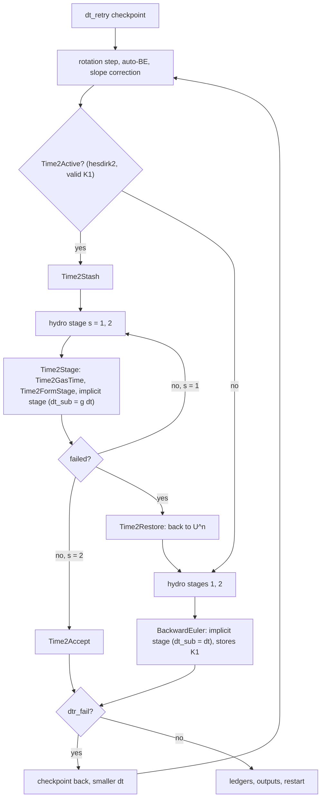
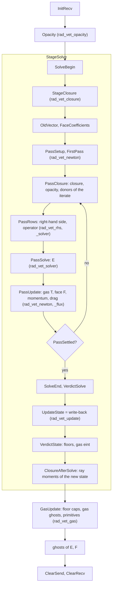
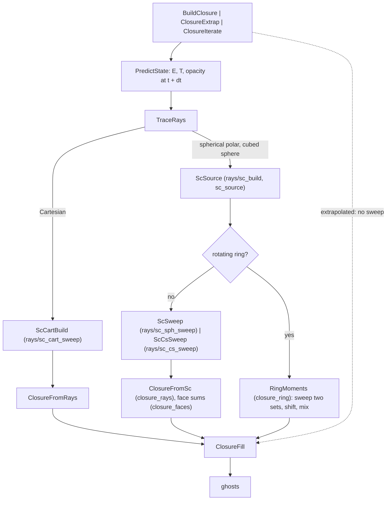
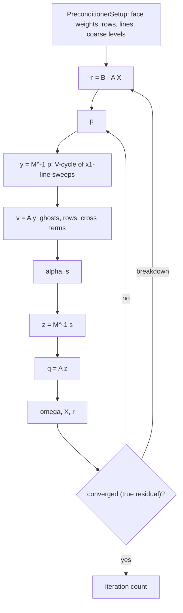

# Workflow of `<rad_vet>`: what runs, in what order, and where to read it

Open **`src/rad_vet/rad_vet_tasks.cpp`** first: the task lists and the implicit stage solve
(`StageSolve`) as a driver of named steps. The equations are in [SCHEME.md](SCHEME.md), the keys in
[KEYS.md](KEYS.md). Paths below are relative to `src/rad_vet/`.

## 1. One time step (`Driver::Execute`, `driver/driver.cpp`; `rad_vet_imex.cpp`)

## 2. One implicit stage (the `vet_*` task lists, `rad_vet_tasks.cpp`)

The face flux solve (`FluxSolve`, `rad_vet_flux.cpp`): F^H and the dissipation -> line ends across
MeshBlocks (`rad_vet_flux_schur.cpp`) -> x1-line solve -> shared faces and panel seams (`rad_vet_flux_seam.cpp`)
-> bound |F| <= c E and the steady balance (`rad_vet_flux_bounds.cpp`).

## 3. The closure (`rad_vet_closure*.cpp`, `rays/`)

## 4. The linear solve for E (`rad_vet_solver.cpp`)

## 5. Files

| file | what |
|---|---|
| `rad_vet_tasks.cpp` | task lists, `StageSolve` |
| `rad_vet_imex.cpp`, `rad_vet_fct.cpp` | IMEX stages; limited face energy fluxes |
| `rad_vet_opacity.cpp`, `rad_vet_gas.cpp`, `rad_vet_newdt.cpp` | opacity; gas after the solve; time step |
| `rad_vet_closure.cpp`, `_closure_rays`, `_closure_faces`, `_closure_ring` | closure: state and choice; cells; faces; rotating sets |
| `rad_vet_oldvector.cpp`, `rad_vet_rhs.cpp`, `rad_vet_newton.cpp` | stage start; right-hand side; passes |
| `rad_vet_solver.cpp` | operator, preconditioner, BiCGStab |
| `rad_vet_flux.cpp`, `_flux_schur`, `_flux_bounds`, `_flux_seam` | face fluxes |
| `rad_vet_update.cpp`, `rad_vet_ledger.cpp` | write-back; L_z and energy ledgers, reports |
| `rad_vet_bvals.cpp`, `rad_vet_reduce.hpp` | ghost exchange, global sums |
| `rad_vet.cpp`, `rad_vet_params*.cpp`, `rad_vet_init.cpp`, `rad_vet_geometry.cpp` | constructor; keys; arrays; geometry |
| `rad_vet_steady.cpp`, `rad_vet_restart.cpp` | steady start; restart and dt_retry |
| `rad_vet.hpp`, `rad_vet_defs.hpp` | the class; slots and small structs |
| `rad_vet_args.hpp`, `_faces`, `_rows`, `_momentum`, `_flux`, `_moments` `.hpp` | device functions |
| `rays/sc_cart_*` | short characteristics, Cartesian |
| `rays/sc_sph_*` | short characteristics, spherical polar |
| `rays/sc_cs_*` | short characteristics, cubed sphere |
| `rays/sc_*` (others) | shared by both curved meshes: directions, tables, source, build, set-up, band ring |

Every file starts with what it does, from which files it is called and into which it calls.
