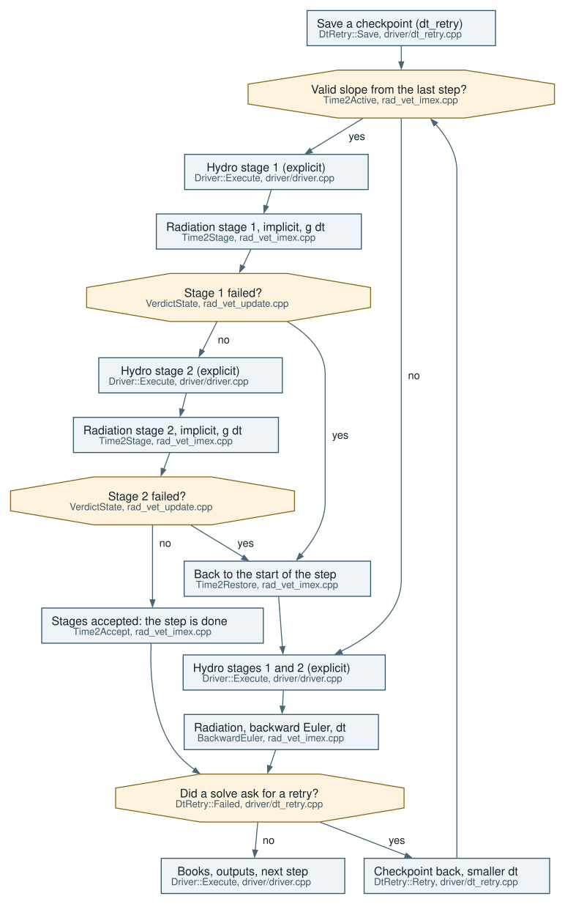
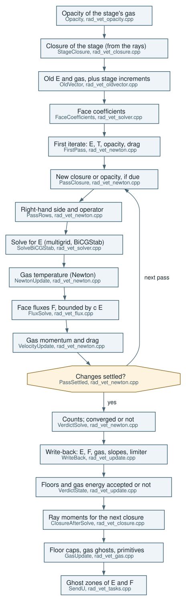
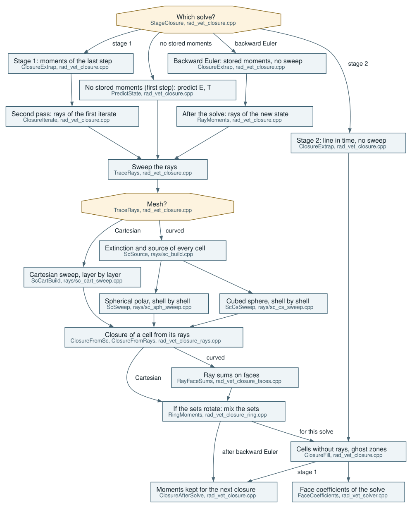

# Code layout

How the radiation module `src/rad_vet/` is laid out: what runs, in what order, and which file holds
it. To read the code, open `rad_vet_tasks.cpp` first. It holds the task list and the radiation solve
as a list of named steps. Every source file starts with what it does, from where it is called and
where it calls into. The method is described in [SCHEME.md](SCHEME.md), the input keys in
[KEYS.md](KEYS.md).

In the charts a box names the step, the function and the file. Yellow boxes are decisions.

## 1. One time step

| step | detail |
|---|---|
| checkpoint | Only with `dt_retry`. It keeps every array of the hydrodynamics and the radiation. |
| valid slope | `Time2Active`: the two-stage scheme is on and the slope of the last step's solve is known. The first step has none. |
| radiation stage | `Time2Stage`: `Time2FormStage` forms the starting point of the stage (slopes, and with `time2_face_fct` the limited face energy fluxes of `Time2FaceFct`), then `RunStage` runs the solve of section 2. |
| failed stage | The solve did not converge, the energy density is negative, or the gas energy is below its floor (`VerdictState`). `Time2Restore` puts the start of the step back, and the hydrodynamics and one backward-Euler solve redo it. If a retry was asked for already, the redo is skipped. |
| backward Euler | One implicit solve over the whole step (`BackwardEuler`); it also gives the slope for the next step. |
| retry | A solve that fails after that asks for a smaller step (`DtRetry::Failed`, `DtRetry::Retry`). |

## 2. One radiation solve

The steps from the closure to the ray moments are the function `StageSolve` in `rad_vet_tasks.cpp`. The
other boxes are tasks of the same list (`AssembleRadVetTasks`).

| step | detail |
|---|---|
| old E and gas | The start of the stage, with the increments of the IMEX stages (`OldVector`). |
| right-hand side and operator | `RightHandSide` in `rad_vet_rhs.cpp`, `PreconditionerSetup` in `rad_vet_solver.cpp`. |
| solve for E | BiCGStab (`SolveBiCGStab`) with the operator `ApplyOperator` and the multigrid cycle `VCycle`, all in `rad_vet_solver.cpp`. |
| face fluxes F | `FluxSolve`: one line system per x1 line. `FluxSchur` (`rad_vet_flux_schur.cpp`) makes the lines exact across blocks, `FluxCone` (`rad_vet_flux_bounds.cpp`) bounds F by c E, `FluxTie` and `FluxCsShared` (`rad_vet_flux_seam.cpp`) give a shared face one value. |
| changes settled | Changes of E and of the gas velocity below the tolerance, or at their round-off level (`PassSettled`). |
| write-back | E, the cell and face fluxes, the gas and the slopes. With `clean_wb_fct` the limiter `WbFct` (`rad_vet_fct.cpp`) limits the face energy fluxes so that E stays above its floor. The books of angular momentum and boundary energy are in `rad_vet_ledger.cpp`. |
| floors accepted or not | `VerdictState`: a stage fails, or the step asks for a retry. |
| after the solve | `GasUpdate`: caps on floor gas, ghost zones of the gas, primitives. |

## 3. The closure and the rays

The chart is for the default `closure_form` = extrap1 with the SDIRK2 stages (`<hydro>` and `<mhd>`). A step then sweeps the
rays once.

| when | sweeps |
|---|---|
| two-stage step | One, in the second pass of stage 1 (`ClosureIterate`). Stage 2 takes a line in time through the stage-1 moments of this step and the last one. |
| backward-Euler step | One, after the solve (`RayMoments`). After a failed stage its sweep comes on top. |
| first step | Two: before and after its solve. No moments are stored yet, so `BuildClosure` predicts the state first. |
| steady start | Two per pass, before and after its solve (`SteadyStart` in `rad_vet_steady.cpp`). |

With rotating direction sets (`ring`), `RingMoments` in `rad_vet_closure_ring.cpp` sweeps the two
live sets and mixes their moments with those of the older sets. The direction sets and their rotation are
in `rays/sc_directions.cpp`, the halo exchange of a sweep in `rays/sc_sph_halo.cpp` and `rays/sc_cs_halo.cpp`.

## 4. Files

Paths are relative to `src/rad_vet/`.

| file | what |
|---|---|
| `rad_vet_tasks.cpp` | Task list, the radiation solve as named steps |
| `rad_vet_imex.cpp` | Stages of a step, backward-Euler step, restore after a failed stage |
| `rad_vet_fct.cpp` | Limited face energy fluxes |
| `rad_vet_opacity.cpp` | Opacity of the gas |
| `rad_vet_closure.cpp` | Which closure, predicted state, call of the rays |
| `rad_vet_closure_rays.cpp`, `rad_vet_closure_faces.cpp` | Closure of a cell; ray sums on faces |
| `rad_vet_closure_ring.cpp` | Rotating direction sets |
| `rad_vet_oldvector.cpp`, `rad_vet_rhs.cpp` | Start of a stage; right-hand side |
| `rad_vet_newton.cpp` | The passes: first iterate, gas temperature, momentum, stop test |
| `rad_vet_solver.cpp` | Operator, preconditioner, BiCGStab |
| `rad_vet_flux.cpp`, `rad_vet_flux_schur.cpp`, `rad_vet_flux_bounds.cpp`, `rad_vet_flux_seam.cpp` | Face fluxes |
| `rad_vet_update.cpp` | Write-back |
| `rad_vet_gas.cpp` | Gas after the solve |
| `rad_vet_ledger.cpp` | Books of angular momentum and boundary energy, reports |
| `rad_vet_bvals.cpp`, `rad_vet_reduce.hpp` | Ghost zones, global sums |
| `rad_vet_newdt.cpp` | Time step, signal speed for the hydrodynamics |
| `rad_vet_steady.cpp`, `rad_vet_restart.cpp` | Steady start; restart records |
| `rad_vet.cpp`, `rad_vet_params.cpp`, `rad_vet_params_matter.cpp`, `rad_vet_params_closure.cpp`, `rad_vet_params_implicit.cpp` | Constructor and keys |
| `rad_vet_init.cpp`, `rad_vet_geometry.cpp` | Arrays; geometry |
| `rad_vet.hpp`, `rad_vet_defs.hpp` | The class; array slots and small structs |
| `rad_vet_args.hpp`, `rad_vet_faces.hpp`, `rad_vet_rows.hpp`, `rad_vet_momentum.hpp`, `rad_vet_flux.hpp`, `rad_vet_moments.hpp` | Device functions |
| `rays/sc_cart_sweep.cpp`, `rays/sc_cart_sweep_mb.cpp`, `rays/sc_cart_setup.cpp`, `rays/sc_cart_rotavg.cpp` | Short characteristics, Cartesian |
| `rays/sc_sph_sweep.cpp`, `rays/sc_sph_halo.cpp`, `rays/sc_sph_walls.cpp` | Short characteristics, spherical polar |
| `rays/sc_cs_sweep.cpp`, `rays/sc_cs_halo.cpp`, `rays/sc_cs_setup.cpp` | Short characteristics, cubed sphere |
| `rays/sc_source.cpp`, `rays/sc_build.cpp`, `rays/sc_setup.cpp`, `rays/sc_tables.cpp`, `rays/sc_directions.cpp`, `rays/sc_bandring.cpp` | Shared by both curved meshes |

Outside the module: `driver/driver.cpp` (the step), `driver/dt_retry.cpp` (checkpoint), `utils/imex_sdirk2.hpp`
(tableaux), `utils/repro_sum.hpp` (layout-invariant sums), `bvals/physics/rad_vet_bcs.cpp` (boundary conditions).

The charts are drawn from the Mermaid sources in `docs/vet_clean/figures/flow/` by `flow.py --render`. `flow.py
--check` fails when a function, file or key named in a chart or on this page does not exist.
